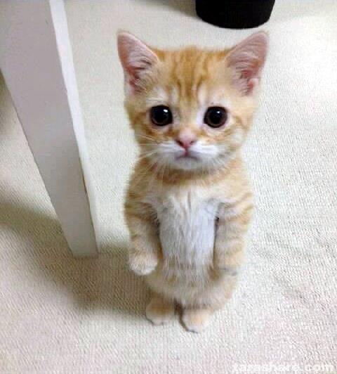

# Images

A loaded image is an immutable resource. An image object places that resource in the
scene, with its own dimensions, transform, lifetime, and style. Several objects can
share the same resource.

<script setup>
import kittenPhoto from './projects/images/assets/kitten.jpg?url'
import profilePhoto from './projects/images/assets/cat-profile.jpg?url'
import closeupPhoto from './projects/images/assets/cat-closeup.jpg?url'
</script>

## Load a resource and display it

Copy <a :href="kittenPhoto" download="kitten.jpg">the kitten photo</a> to `assets/kitten.jpg` inside your project.
The guide demonstrations use the supplied photos rather than generated illustrations.



The source is 480 × 532 pixels. `k.load_image` loads its bytes. `k.image_2d` creates
the object, and `add` makes it visible. A loaded 2D image adopts its source dimensions
before explicit property options are applied.

<GuideDemo name="image-load" caption="The original photo appears centered at 60 percent scale." still>

<!-- demo: image-load -->
<<< ./projects/images/scenes/01-image-load.lua

</GuideDemo>

Its local size is still 480 × 532. Scale makes the visible rectangle 288 × 319.2 units.
Try removing `scale` to compare the natural size. Paths are relative to the project
root, even when the Lua scene is in `scenes/`. See [asset paths](projects.md#assets-paths-and-modules).

## Preserve the aspect ratio

Changing `size` changes the rectangle into which the pixels are drawn. Equal scale on
both axes preserves proportions. Arbitrary width and height can stretch the photo.

<GuideDemo name="image-aspect" caption="Left: original proportions at half size. Right: the same pixels squeezed vertically." still>

<!-- demo: image-aspect -->
<<< ./projects/images/scenes/02-image-aspect.lua

</GuideDemo>

The left height is `240 * 532 / 480 = 266`. On the right, width stays the same but
height shrinks. Try `size = k.vec2(240, 266)` on both and compare again. Increasing size
or scale cannot add detail to the original pixels.

## Turn a photo into a white circle

Animate the rectangle into a square while its corners reach half the final size.
At the same time, bring the white fill from transparent to opaque. The image's fill
is drawn over its pixels, so this reveals a solid white circle without fading the
whole object away.

<GuideDemo name="image-motion" caption="The photo rounds into a circle as the white fill covers its pixels.">

<!-- focus: image-motion -->
```lua
picture:to {
    size = k.vec2(280, 280),
    round = k.quad(140, 140, 140, 140),
    fill = k.color("#FFFFFF"),
}:play(2)
```

<template #source>

<!-- demo: image-motion -->
<<< ./projects/images/scenes/03-image-motion.lua

</template>

</GuideDemo>

A 280 × 280 square becomes circular with a 140-unit radius at every corner. The
starting fill has white RGB and zero alpha. Animating that alpha preserves a clean
white overlay. `opacity` would instead fade the image and its styling together.

## Put a photo in 3D

Copy <a :href="profilePhoto" download="cat-profile.jpg">the profile photo</a> to `assets/cat-profile.jpg`.
`image_3d` is a plane in local XY with its front facing positive Z. Its default unlit
material shows the photo without needing a light.

<GuideDemo name="image-spatial" caption="The profile photo turns as a plane in 3D space.">

<!-- demo: image-spatial -->
<<< ./projects/images/scenes/04-image-spatial.lua

</GuideDemo>

Without an explicit size, `image_3d` converts pixels to spatial units using
`pixels_per_unit` (256 by default). A 236 × 260 source therefore starts at
`236 / 256` by `260 / 256` units. Explicit size overrides those dimensions. Try
changing the camera distance to see how perspective changes its apparent size.

## Sample a source pixel

Copy <a :href="closeupPhoto" download="cat-closeup.jpg">the close-up photo</a> to
`assets/cat-closeup.jpg`. Move one point across its local rectangle, and use two signals
to display that point: a ring on the photo and a square filled with the sampled color.

<GuideDemo name="image-sample" caption="The ring scans the photo while the square displays the pixel under it.">

<!-- focus: image-sample -->
```lua
cursor:signal(function(object)
    local p = point:get()
    object.position:set(k.vec2(p.x - 180, p.y))
end)
swatch:signal(function(object)
    object.fill:set(picture:get_pixel_color(point:get()))
end)

point:to(k.vec2(120, 80)):play(2)
point:to(k.vec2(-120, -80)):play(2)
```

<template #source>

<!-- demo: image-sample -->
<<< ./projects/images/scenes/05-image-sample.lua

</template>

</GuideDemo>

`point` holds coordinates inside the image. The cursor adds the image's X offset to
place the ring in the world. Both signals read the same animated track, so the swatch
matches the ring even when seeking directly to a different time.

`get_pixel_color` reads source pixels before styling, opacity, or shaders. Points
outside the local rectangle return transparent black. The query also works on 3D
images, using a local `vec2` on their plane.

## Image resources and live canvas textures

A loaded image keeps fixed pixels for an applied revision. A canvas texture is rendered
at the evaluated time, so its contents can animate. Use `projection_2d` or
`projection_3d` with `source = canvas:texture()` to display it. Pixel sampling requires
an image source and does not read live GPU canvas pixels. See [canvases](canvases.md).

Images are limited to 64 MiB of encoded data and 16 million decoded pixels. Resource
paths stay fixed during export. Loading a new revision is separate from changing a
visible object's position or opacity. See [Image2D](../api/Image2D.md) and
[Image3D](../api/Image3D.md) for the available property handles.
